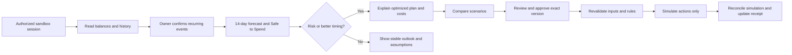
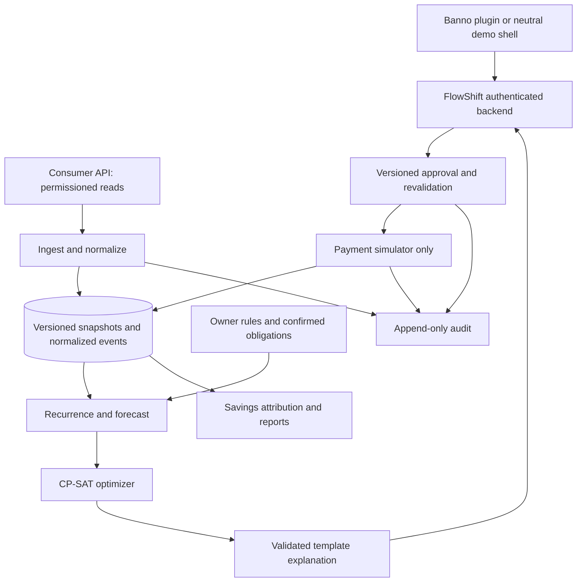

# FlowShift Product And Engineering Specification

Status: documentation-only handoff, not an implemented product. Date: October 19, 2026.

## 1. PM Intent

Build a cash-timing assistant for small-business owners inside their existing bank experience. Owners should be able to answer: **What can I safely spend today? Will payroll clear? What should I pay when? Is paying for speed worth it?**

The product is a deterministic decision engine, not a chatbot. Forecasts are estimates, not guarantees. Every displayed amount and recommendation MUST be traceable to inputs, calculations, and a versioned decision. Language models may polish an explanation but may not determine amounts, authorize actions, or call payment tools.

Commercial context from the proposal: B2B2B distribution through financial institutions. Free/basic and paid-autopilot tiers, bank platform fees, payment revenue share, and credit referrals are hypotheses, not MVP billing requirements or validated revenue forecasts.

### Scope And Authority

Priority when sources disagree: safety requirements in this handoff, reconciled calculation fixtures, written feature behavior, then visual styling. PM must approve material changes before implementation. [Section 12](#12-source-conflicts-and-pm-decisions) records unresolved decisions.

| Phase | Required scope | Explicit exclusions |
| --- | --- | --- |
| MVP | USD, one selected business checking account per plan; sandbox reads; synthetic fixtures; recurrence confirmation; 14-day forecasts; optimizer; seven reference experiences; manual approval; simulated execution; rules and autopilot preview; receipts; audit | Real debits/credits, production payment credentials, live automatic approval, guaranteed savings, real loans, automated invoice OCR, production accounting integrations |
| Pilot | Bank-sponsored embedding, verified data rights and retention, payment-provider staging integration if separately approved, real-user usability testing | Unreviewed live movement, unsupported rails, automatic lending decisions |
| Production later | Bank-authorized live payment adapters, reconciled settlement, institution-reviewed autopilot, security/compliance/operations readiness | Assumed entitlement from a sandbox login, universal compatibility, guarantees against overdrafts |

Switching accounts is supported as a context change; pooling money or automatically transferring between accounts is not MVP scope. A USD-only scope MUST reject unsupported currencies rather than add them together.

## 2. Actors And Permissions

| Actor | Allowed behavior | Limits |
| --- | --- | --- |
| Business owner/authorized approver | Confirm obligations; change rules; compare, approve, reject, or cancel eligible simulated actions; download reports | Must have institution/business/account authorization; no cross-tenant access |
| Business viewer | Inspect permitted forecasts, plans, receipts | Cannot approve, change rules, or add payees |
| Bank support/operator | Inspect institution-scoped redacted diagnostics and audit history; pause institution execution | Cannot impersonate owner approval or edit historical decisions |
| System worker | Ingest, forecast, optimize, send eligible notifications, simulate approved actions | Bound to account, environment, current authorization, rules, and idempotency controls |

These roles are FlowShift requirements, not a claim that matching Jack Henry role scopes exist. Map to actual institution entitlements during discovery; deny mutations when permissions cannot be verified. MVP can demonstrate viewer/owner roles with synthetic identities.

## 3. Critical User Journey



Approval is not settlement. A pending or failed action MUST never appear as completed or as realized savings.

## 4. Use Cases And Acceptance Criteria

All cases require tenant isolation, auditability, explicit data mode, and understandable loading/empty/error states. P0 is required for a credible MVP; P1 follows the P0 vertical slice but remains part of the semester handoff.

| ID / priority | User intent and behavior | Acceptance criteria |
| --- | --- | --- |
| UC-01 / P0 | Enter FlowShift through an authorized bank/sandbox context | Explicit consent and least-privilege access; account context visible; denied/revoked consent stops reads and new actions; no bank credential collection |
| UC-02 / P0 | Select a business account and synchronize data | Display balance type, currency, as-of time, and mode; page through history; deduplicate and reconcile pending-to-posted changes; empty/error states do not show invented balances |
| UC-03 / P0 | Confirm recurring payroll, rent, supplier bills, insurance, and settlements | Suggest merchant, signed amount/range, cadence, next date, and confidence; user can confirm, edit, reject, or enter manually; unconfirmed inferred inflows cannot fund safety decisions |
| UC-04 / P0 | See the daily cash plan | Show Safe to Spend, action-needed count, reserve, data freshness, and feed filters All/Alerts/Suggestions/Savings; selecting a feed item opens its source plan/event; empty filter has a distinct state |
| UC-05 / P0 | Inspect the 14-day forecast | Exactly 14 local dates including today; expected and P10/P90 paths, reserve line, event drilldowns, lowest balance, and assumptions; accessible data table; no unsupported confidence claims |
| UC-06 / P0 | Detect payroll risk before funding deadline | Alert on payroll funding-time shortfall, not only payday; target 72 hours if data permits; identify amount, date, assumptions, and available fixes; urgent immediate alert if first detected inside that window |
| UC-07 / P0 | Review a Payroll Shield fix | Show ordered actions, before/after low point, deadline impact, reserve impact, total fees, and risks; keep payroll on time; if no feasible plan, clearly say so and request manual action |
| UC-08 / P0 | Use Smart Pay for each bill | Display invoice amount, actual due/arrival deadline, initiation date, eligible rail, fee, and rationale; sort by due date; preserve third-party auto-debits as non-movable commitments |
| UC-09 / P1 | Capture early-payment discounts | Owner-confirmed terms required; compare discounted amount plus fees against undiscounted amount; recommend only if hard safety/deadline/reserve policy passes; disclose discount expiry |
| UC-10 / P0 | Compare what-if scenarios | Change supplier timing, eligible payout acceleration, or reserve assumptions in a draft; show identical starting data and before/after paths; no execution or rule change until explicit approval/save |
| UC-11 / P0 | Approve or reject a proposed plan | Review exact account, payees, amounts, dates, rails, fees, and version; revalidate before simulation; reject expired/stale versions; double taps produce one approval and one action per obligation |
| UC-12 / P0 | Track or cancel simulated actions | Show scheduled, processing, settled, failed, cancelled, or unknown status per action; cancel only if allowed before submission; partial failure remains visible and triggers a new risk calculation |
| UC-13 / P1 | Set reserve and guardrails | Validate reserve >= 0; amount ceiling includes fees; protect payroll by default; require approval for new/changed payees; save version atomically; unsaved edits do not change active decisions |
| UC-14 / P1 | Preview autopilot and historical rules | Enable only labeled simulation/preview; evaluate each action plus combined plan against limits, reserve, deadlines, authorization, payee eligibility, and fresh data; report what would have been approved, not what was paid |
| UC-15 / P1 | Review Savings Receipt | Monthly/year filters, category breakdown, counts, evidence drilldowns, and CSV export; gross benefits, incremental costs, and net savings reconcile; simulation, estimates, and realized results stay separate |
| UC-16 / P1 | Receive timely alerts | Proposed 7:00 a.m. business-timezone summary; deduplicate payroll risks; group related actions; preferences affect routine messages, not mandatory security/critical risk notices; do not leak amounts in lock-screen previews by default |
| UC-17 / P0 | Understand why an action helps | Template-first explanation references the exact plan version and numbers; if optional LLM fails or alters a number, use template; no unverified promise of payroll safety or guaranteed savings |
| UC-18 / P0 | Recover from lost data access | Mark cached information stale; block approvals until refreshed; preserve audit; explain reconnection path; revoked tokens are unusable even by scheduled jobs |
| UC-19 / P0 | Audit a decision or result | Authorized actor can trace source snapshots, normalization, confirmed obligations, model/solver versions, rules, approval, simulator outputs, and receipt attribution with correlation IDs |
| UC-20 / P0 | Run a repeatable demo or backtest | Fixed clock and seeds; synthetic business set; documented counterfactual baseline; reproducible outputs; no production secrets, customer data, or network submission |

### Approval Detail Contract

Immediately before approval, disclose all actions individually and as a plan. Include what changes, what cannot change, old/new initiation and arrival dates, fees, total outflow, expiring quotes, and the forecast used. Partial selection requires a new jointly validated plan; do not allow users to remove a prerequisite and keep an unsafe dependent action.

## 5. Calculation And Safety Rules

### 5.1 Ledger And Forecast

- MUST use integer USD cents or fixed-point decimal; never binary floating-point money. Store UTC timestamps and business/institution IANA timezones; keep local due dates separate from timestamps.
- A plan begins with the institution-reported available balance and its as-of timestamp. Retain ledger balance and holds separately. Subtract future debits only when not already reflected in that opening available balance; document the provider-specific mapping.
- Reconcile pending and posted events using provider lineage where available. A bank transaction, invoice, scheduled payment, and recurring prediction representing one economic event MUST count once.
- Forecast is today through today + 13 local calendar days. Include known expenses beyond this window as a visible limitation; do not claim the number is safe indefinitely.
- Produce daily expected and P10/P90 balances from documented scenario/model assumptions. P10 is a lower balance estimate, not a guarantee. Pointwise P10 safety is not a 90% probability of safety across the entire horizon.
- Add funding-deadline checkpoints and adverse within-day event ordering (debits before uncertain credits) to safety tests. End-of-day totals cannot prove payroll can be funded in the morning.
- Proposed recurrence starting point: 90 days of history where available, at least three similar occurrences to auto-suggest, owner confirmation for decision-critical obligations. Lower history coverage MUST reduce confidence and trigger manual onboarding, not fabricated certainty.
- Refresh on new transactions, obligation changes, rule changes, and action status changes. Scheduled refresh covers missing push events; actual refresh capabilities depend on the chosen API and institution.

### 5.2 Safe To Spend

Proposed implementable default: let `B_safe(k)` be the conservative balance at every relevant checkpoint in the active plan, **before new discretionary spending**, and `R` the reserve.

```text
headroom = min_over_checkpoints(B_safe(k) - R)
safe_to_spend_cents = max(0, headroom)
reserve_gap_cents = max(0, -headroom)
```

This tests an additional immediate debit against the whole horizon. It is not simply today's balance minus a sum that ignores inflows and their timing. A draft scenario MUST NOT change the headline active-plan number. Before approval, use current committed timings; after approval, clearly label the number as based on simulated scheduled actions in MVP. Unsettled accelerated funds remain a dependency, not cash already received. Exclude unapproved draft changes. If critical inputs are missing or stale, show **Unavailable**, not `$0` with a false claim of safety.

### 5.3 Optimizer

Use OR-Tools CP-SAT (as proposed), with integer amounts and versioned deterministic tie-breaking. Each obligation selects exactly one allowed action/date/rail combination. Immutable obligations have fixed choices. Payout acceleration moves an existing inflow; it does not create a second inflow.

```text
minimize:
  rail_fees + payout_fees + allowed_noncritical_late_penalties
  - confirmed_early_pay_discounts
  + reserve_penalty_weight * sum(max(0, reserve - conservative_balance[k]))

hard constraints:
  conservative_balance[k] >= 0 at every safety checkpoint
  payroll and critical funding/arrival deadlines met
  institution/payee/amount/rail eligibility met
  exactly one action per obligation; prerequisite ordering respected
  reserve respected when strict-reserve policy is enabled
```

The proposal uses a soft reserve penalty; mockups imply a hard reserve floor. **Default for this handoff: strict reserve ON.** If strict reserve makes the plan infeasible, offer an explicitly labeled manual reserve exception for PM-approved future behavior, never silently override it or auto-approve it. No credit-line draw or interest calculation in MVP.

Configure a solver time budget and record status. Only a proven optimal solution may be called optimal. A feasible-but-not-proven solution may be labeled best found; timeout with no feasible solution MUST produce no approval-ready plan. Proposed initial budget: 2 seconds per small demo instance; benchmark before committing a performance promise.

### 5.4 Rail And Settlement Rules

Choose the least total-cost eligible action that meets deadlines and safety constraints, not automatically the fastest rail. Arrival deadline and send date are distinct. Use institution/provider cutoffs, holidays, service availability, fee quotes, and configured limits; do not hard-code marketing speed or network maximums.

RTP/FedNow availability is not the ability to accelerate a merchant's card settlement. Early payout requires a merchant/acquirer/provider product, consent, supported payout destination, current quote, and actual availability. MVP simulates it explicitly. Never relabel the mockup's `$18.84` payout **fee** as the payout principal.

### 5.5 Rules And Autopilot

- Proposed ceiling is inclusive (`amount + associated fees <= ceiling`), despite ambiguous "under" wording in the mockup. Evaluate both per-action and aggregate daily/plan exposure; no splitting to bypass thresholds.
- Payroll protection and nonnegative balances are hard constraints. The owner cannot disable them for automatic action. A reserve change triggers full replanning and invalidates old approvals.
- A new payee or changed destination requires new human approval regardless of amount. Editing an approved payee's bank details invalidates old approvals.
- "Use instant rails only when cheaper" compares documented incremental costs and confirmed benefits of feasible alternatives. If no cheaper safe option exists, propose the safety-critical cost for manual approval, disclose the trade-off, and do not auto-approve under an incompatible rule.
- Pause/disable autopilot prevents new approvals, not cancellation of already submitted transfers. MVP never enables live autopilot.

### 5.6 Savings Receipt

```text
gross_modeled_benefit = avoided_fees + captured_discounts
net_modeled_savings = gross_modeled_benefit - incremental_execution_costs
```

Prevent overlap: an avoided overdraft fee cannot appear again inside a generic avoided-fee category. Principal is not savings. Reserve preserved is not savings. Overdrafts prevented is a count, not automatically a dollar amount. Time saved is a separately labeled estimate with a documented method. Cap fee avoidance by the documented fee policy and counterfactual, not one fee per arbitrary action.

Store counterfactual plan, fee assumptions, action lineage, and attribution method. Estimates and counterfactual fee avoidance are not verified cash credits. Only an actually received, reconciled discount can be described as captured in a future live system. Returns/reversals append corrections, do not silently rewrite prior receipt entries. MVP receipts MUST say simulated.

## 6. Canonical Arithmetic Fixture

The PDF's example is internally inconsistent unless an overdraft fee is added explicitly. Preserve the source PDF unchanged, but use the following reconciled fixture for tests, UI, and explanations. These figures are synthetic assumptions, not provider quotes.

Use Monday April 20, 2026 as the start; future dates beyond Friday are flat for this fixture. No holds or hidden expenses. All known amounts are certain, so P10 = expected = P90 for this arithmetic-only test. Payroll is funded at a specified Thursday checkpoint; accelerated funds arrive before it. Supplier arrival Friday is confirmed eligible; actual ACH initiation may need to happen earlier. Reserve is $2,000. Baseline permits diagnostic negative balances to expose infeasibility, not to authorize an overdraft.

| Event | Baseline | Reschedule only | Reschedule + accelerate |
| --- | ---: | ---: | ---: |
| Monday opening balance | $8,400.00 | $8,400.00 | $8,400.00 |
| Tuesday supplier debit | -$1,800.00 | $0.00 | $0.00 |
| Wednesday rent + insurance | -$2,888.00 | -$2,888.00 | -$2,888.00 |
| Thursday accelerated settlement | $0.00 | $0.00 | +$3,140.00 |
| Thursday acceleration fee (0.6%) | $0.00 | $0.00 | -$18.84 |
| Thursday payroll | -$4,000.00 | -$4,000.00 | -$4,000.00 |
| Thursday balance before overdraft fee | -$288.00 | $1,512.00 | $4,633.16 |
| Thursday modeled baseline overdraft fee | -$35.00 | $0.00 | $0.00 |
| Friday standard settlement | +$3,140.00 | +$3,140.00 | $0.00 |
| Friday supplier debit | $0.00 | -$1,800.00 | -$1,800.00 |
| Lowest modeled balance | -$323.00 | $1,512.00 | $2,833.16 |
| Friday ending balance | $2,817.00 | $2,852.00 | $2,833.16 |

Assertions: baseline violates nonnegative balance; reschedule-only violates strict reserve by $488.00; combined plan preserves reserve by $833.16. Combined-scenario Safe to Spend is $833.16; current-baseline Safe to Spend is $0.00. In a baseline without the modeled overdraft fee, the low point is -$288.00, not -$323.00. Net modeled benefit of the combined plan vs baseline is $16.16 ($35.00 avoided less $18.84 paid), while the zero-cost reschedule-only option is inadmissible under strict reserve.

This fixture tests arithmetic, not forecast calibration or proof of economic optimality across every imaginable product. Engineers must enumerate the configured eligible actions and test optimizer selection; no credit product or free acceleration may be assumed.

## 7. Edge-Case Matrix

This matrix is the required baseline for QA, not a claim that every possible financial edge case is enumerated. Extend it as provider contracts and bank policies become known. P0 use cases require automated coverage of applicable rows before MVP sign-off.

| ID | Trigger | Expected behavior and test oracle |
| --- | --- | --- |
| EC-01 | No history or new business | Manual obligations; low-confidence state; no fabricated recurrence; block approval if critical cash picture is unknown |
| EC-02 | Empty account or negative starting balance | Zero/unavailable spending as appropriate; explicit shortfall; no infeasible approval-ready plan |
| EC-03 | Pending debit becomes posted | One economic outflow across both records; opening-balance reconciliation remains correct |
| EC-04 | Duplicate imports, page overlap, replayed sync | Stable event identity/version; no duplicated amounts or alerts |
| EC-05 | Refund, reversal, ACH return, chargeback | Link compensating event; reforecast and adjust receipt attribution; keep original evidence |
| EC-06 | Hold or restricted balance | Use spendable availability; never fund payroll with unavailable ledger funds |
| EC-07 | API timeout, rate limit, or incomplete pagination | Bounded backoff/retry; mark partial/stale; do not replace complete snapshot with partial truth |
| EC-08 | Consent expiry, revoked token, account removed | Deny new work, invalidate approvals, show reconnect path; retain only policy-permitted audit data |
| EC-09 | Account switch or shared-device session | Clear prior account content and drafts; scope all resources server-side; no old-user cached balance |
| EC-10 | Multiple currencies/accounts | Reject unsupported currency/pooling; no fake FX or cross-account liquidity |
| EC-11 | Variable payroll or multiple payroll runs | Confirm amount/range and separate funding deadlines; protect every run jointly |
| EC-12 | Recurrence skips or merchant names change | Confidence drops; confirm merges/edits; no duplicate inferred and manual bill |
| EC-13 | Weekend, holiday, DST, or missed cutoff | Recompute initiation from arrival deadline using institution calendar and timezone; 14 dates stay correct |
| EC-14 | Payroll funded before same-day incoming credit | Test intraday checkpoints; do not count late inflow toward early payroll |
| EC-15 | Ordinary ACH cannot arrive in time | Offer eligible same-day/instant option or no feasible plan; never assume same-day service outside cutoff |
| EC-16 | Instant rail unavailable for payee/bank/amount | Remove choice; routing-number eligibility alone is not payee or account verification |
| EC-17 | Acceleration unavailable, declined, partially available, or reversed | Remove/reduce inflow and rebuild plan; no duplicate standard settlement; payroll fix becomes at risk until resolved |
| EC-18 | Auto-debit controlled by third party | Treat date/amount as immutable until a verified change; do not imply FlowShift rescheduled it |
| EC-19 | Unknown supplier grace period or discount terms | Do not invent terms or promise no late fee; request confirmation; avoid unsupported benefit |
| EC-20 | Discount hurts reserve/payroll | Decline recommendation even if nominal return looks attractive |
| EC-21 | Forecast paths diverge or history is unusual | Show widened uncertainty; conservative safety checks; reduce automation; no calibrated-coverage label without evidence |
| EC-22 | All actions still produce a shortfall | Explicit infeasible status, amount/date gap, and manual next steps; do not invent credit |
| EC-23 | Solver times out | Distinguish feasible/unproven from infeasible/unknown; never label timeout proof of optimality |
| EC-24 | Fee increases or quote expires before approval | Invalidate plan and approval; disclose revised cost and request confirmation |
| EC-25 | Balance/obligation/rules change during approval | Compare versions, serialize commitment, reforecast; stale approval cannot execute |
| EC-26 | Double tap, browser retry, two approvers | One logical approval/action with stable idempotency key; no two plans commit same obligation |
| EC-27 | New payee or destination changed after approval | Invalidate approval and require payee verification/human review |
| EC-28 | Amount exactly at ceiling or split payments | Inclusive fee-aware threshold; aggregate exposure prevents bypass |
| EC-29 | Worker crashes after submission | Unknown state; reconcile by stable reference before any retry; never submit another payment blindly |
| EC-30 | Multi-action plan partly succeeds | Keep settled actions; stop unsafe dependents; reforecast and alert; no pretend atomic rollback |
| EC-31 | Cancellation after submission/finality | Show not cancellable; no promise of undo; a recall/return is a distinct future-bank workflow |
| EC-32 | Duplicate/out-of-order webhook | Verify authenticity; deduplicate; never regress terminal status; returns modeled separately |
| EC-33 | Invalid webhook signature or replay | Reject/quarantine; no balance or status change; log redacted security evidence |
| EC-34 | Lost webhook/provider outage | Periodic reconciliation; show unknown instead of settled; pause unsafe approvals |
| EC-35 | Rule save fails or concurrent editor overwrites | Preserve active version; show conflict; no silent last-writer-wins affecting an approval |
| EC-36 | Reserve setting exceeds current funds | Show gap; do not clamp reserve silently or imply protection |
| EC-37 | Notifications muted on weekend | Suppress routine messages only; critical risk remains visible/in-app and follows approved mandatory policy |
| EC-38 | Alert arrives late or is repeatedly regenerated | State first-known time; send urgency update on material change; deduplicate same incident |
| EC-39 | LLM unavailable, hallucinates fee, or sees malicious merchant text | Template fallback; numeric validation; treat imported text as untrusted; no tool access |
| EC-40 | Gross savings overlap, cost exceeds benefit, return after report | Deduplicate attribution; allow negative net savings; append correction; exports reconcile |
| EC-41 | Month/year boundary or timezone filter | Bucket by documented business date consistently; totals equal line items |
| EC-42 | Report export contains spreadsheet formulas | Escape formula-leading text; redact account details; enforce authorization and audit export |
| EC-43 | Long payee names, large/negative amounts, mobile zoom | No clipped controls; signs and cents readable; keyboard/screen-reader alternatives and chart table |
| EC-44 | Cross-tenant IDs or downgraded role | Server denies read/mutate/export; resource existence not leaked |
| EC-45 | Synthetic data mistaken for sandbox/live data | Persistent mode label and audit tag; disjoint environment IDs; no mixed receipts |
| EC-46 | Future bill just outside 14-day horizon | Disclose horizon; expose known later obligations separately; no open-ended safety claim |
| EC-47 | Exact zero, one-cent reserve breach, rounding tie | Boundary tests in cents; explicit fee rounding convention; no inconsistent UI/solver precision |
| EC-48 | Scheduled job missed morning run or app offline | Recover job once, show last-updated time; no stale approval or misleading current-day timestamp |

## 8. Proposed Architecture And Data Contracts

This is a bounded implementation recommendation, not existing code. Start as a modular backend plus worker, relational database, and plugin frontend; separate deployable microservices are not required. Engineers choose frameworks in an ADR. Forecasting/CP-SAT can run in Python; keep language boundaries minimal.



| Entity | Minimum contract |
| --- | --- |
| Institution / Business / Membership | Tenant ID, business ID, authorized identity mapping, role, timezone, environment |
| AccountSnapshot | Scoped account ID, currency, available/ledger balances, holds, provider as-of, ingestion time, completeness, version |
| CashEvent | Stable provider/event IDs, signed cents, status, effective/funding dates, pending/posting lineage, category, source confidence |
| Obligation / Payee | Amount/range, recurrence, due and funding deadlines, immutable/movable flag, confirmed terms, destination version, owner confirmation |
| RailCapability / FeeQuote | Institution/payee eligibility, amount limits, calendar/cutoff, fee formula/rounding, quote expiry, provenance |
| RuleSet | Reserve, strict flag, ceiling and aggregate caps, critical obligations, new-payee policy, notification preferences, immutable version |
| ForecastRun | Source versions, model/seed, horizon and checkpoints, expected/P10/P90, assumptions, freshness, calibration label |
| Plan / PlanAction | Version, source run/rules, objective components, solver status, dependencies, before/after paths, exact costs, expiry |
| Approval | Actor/role, exact plan hash/version, timestamp, environment, idempotency key, validation outcome |
| PaymentAttempt | Logical action ID, stable submission key, simulator/provider reference, status history, unknown/reconciliation state |
| SavingsEntry | Action lineage, counterfactual, benefit category, costs, estimate/simulated/realized label, correction reference |
| AuditEvent | Tenant, actor, timestamp, correlation ID, event type, source versions, redacted payload/hash, outcome |

Internal API contracts SHOULD cover snapshot/obligation reads and confirmation, forecasts, scenario creation, approval/rejection, rule updates, action status/cancellation, receipts/export, and authorized audit lookup. Engineers MUST define actual request/response schemas, auth, version conflict responses, and idempotency behavior before UI integration. These are FlowShift interfaces, not Jack Henry endpoint names.

### Execution State And Concurrency

```text
Plan: draft -> proposed -> approved -> executing -> completed | partially_failed | failed
      proposed -> rejected | expired | superseded

Action: scheduled -> processing -> settled | failed | unknown
        scheduled -> cancelled
        unknown -> reconciled settled | reconciled failed
```

Map provider-specific states explicitly later. Approval commits atomically with an obligation reservation and durable job/outbox. Execute dependencies in order; revalidate cash and permissions before each action. Avoid holding database locks across provider calls. An audit failure blocks committing a new approval. A later return is a linked event rather than regression of a settled attempt.

## 9. Security, Reliability, And UX Expectations

- Server-side authorization on every resource and mutation; least privilege; separate institution/business/account context; no trust in client-supplied tenant IDs.
- Tokens/keys encrypted and managed outside Git; separate sandbox/staging/production configuration. No tokens or raw account data sent to optional LLMs or analytics.
- OAuth/OIDC callback validation, CSRF protection, secure session cookies, token expiry/revocation, redirect validation, and reauthentication follow the actual selected framework flow.
- No real payment credentials in MVP. Simulator adapter is the only execution adapter; staging integration, if later approved, is visibly separate.
- Versioned calculations and append-only business audit evidence; privacy-minimized retention and deletion policy agreed with bank before pilot. Do not assert regulatory compliance or claim an audit certification this repo does not have.
- Proposed engineering freshness budget: snapshot <= 15 minutes and fee quote unexpired at approval, with synchronous refresh for decision-critical inputs. Bank/provider constraints may require a stricter policy; fail closed when freshness cannot be established.
- Proposed performance targets: cached view <= 2 seconds and replan <= 5 seconds at p95 on the agreed demo workload, measured separately from upstream outages. Show progress if slower; do not substitute old numbers as current.
- Responsive 360px mobile through desktop, keyboard operation, visible focus, screen-reader labels, accessible errors, WCAG 2.2 AA target, and chart data tables. Do not rely on red/green alone.
- Every experience has loading, no data, no recommendations, stale data, access denied, partial failure, and retry states where applicable. Neutral host-bank branding; no dead-end buttons copied from images.

## 10. Evaluation And Sign-Off

| Evaluation | Required measurement |
| --- | --- |
| Arithmetic correctness | Canonical fixture and cent-level conservation; fee rounding and balance roll-forward invariants pass |
| Forecast accuracy | Proposal target <= 10% at day 7. Proposed metric: mean absolute day-7 balance error divided by max(abs(actual day-7 balance), $1,000), averaged across held-out cases; also report MAE in dollars and near-zero cases. PM/data lead approve metric before claiming target met |
| Forecast uncertainty | Report empirical P10-P90 coverage and interval width on held-out scenarios; target central coverage near 80%, stratified by history length/business type. Do not label synthetic bands calibrated to real businesses |
| Risk detection | Catch >= 90% of injected shortfalls >= 48 hours before funding deadline when observable inputs exist by then; target notifications at 72 hours; separately report late-arriving-input cases and false positives |
| Optimization | Enumerate tiny instances to verify selected feasible minimum-cost choice; compare strict/soft reserve behavior; record solver status, timings, seed, and version |
| Savings | Compare with fixed owner-default baseline on identical inputs; show median annual simulated savings and distribution, not an invented success threshold; avoid extrapolation without disclosure |
| Research | By week 4: interview 15 SMB owners and 3 community-bank staff; proposal goal: at least 10 owners say they would check the number daily. Store only consented/de-identified summaries publicly |
| Demonstration | Seeded 200-business dataset, canonical payroll rescue, infeasible business, stale-data block, rejected/failed action, and savings report with full audit trace |

Use chronological train/test splits and deterministic scenario seeds; no lookahead from future transactions into forecasts. Synthetic results validate mechanics, not real-world financial outcomes. Bank sandbox balance accuracy is not a substitute for a representative forecast backtest.

Definition of MVP done: all P0 cases and applicable edge cases tested; P1 scope completed or explicitly deferred by PM; seven experiences usable; sandbox integration evidence or conspicuous blocked-access status; human approval and simulator only; figures reconcile; demo reproducible; privacy review passed; no undocumented live execution path.

## 11. PM Demo Script

1. Open the synthetic Monday account with $8,400 and a $2,000 reserve; confirm the four obligations.
2. Show baseline payroll risk: -$288 before fee, -$323 with the explicitly modeled fee; spending headroom is $0.
3. Compare moving supplier payment alone: low point $1,512, still $488 below reserve.
4. Add the eligible simulated $3,140 settlement acceleration for $18.84; show low point $2,833.16 and scenario headroom $833.16.
5. Approve the exact combined plan; demonstrate one simulated action per obligation, current status, explanation, and audit history.
6. Show $16.16 modeled net benefit versus the fee-bearing baseline; separately show a failed payout and how payroll risk returns. Never portray the simulation as a real bank payment.

## 12. Source Conflicts And PM Decisions

Defaults below make this handoff actionable but require PM review before implementation. Original source files remain unchanged.

| Topic | Source conflict or unknown | Handoff decision / owner |
| --- | --- | --- |
| Example default low point | Inputs produce -$288; PDF says -$323 | Add explicit $35 modeled overdraft fee only to diagnostic baseline; disclose both numbers. PM approves fixture |
| Thursday combined balance | PDF rounds $4,633; exact calculation $4,633.16 | Use cents internally and consistent display rounding |
| Reserve | Mockups alternate $1,000/$2,000; PDF optimizer penalizes breaches but UX promises protection | Default $2,000 strict reserve in canonical fixture; user-configurable for other businesses; PM approves exception policy |
| Forecast summary | Mockup claims stable protected $2,000 reserve while showing a $1,012 low point | Unsafe state unless clearly labeled reserve-relative; use absolute low point and explicit reserve gap |
| Payroll card | Mockup describes $612 shortfall but labels positive $612 as lowest balance | Distinguish negative balance, shortfall, and reserve gap; do not reuse screenshot arithmetic |
| Settlement annotations | Forecast image mixes $18.84 with $18,840 and mismatched dates | $18.84 is example payout fee; $3,140 is canonical settlement; chart/events share one ledger |
| Savings | Image headline/month totals $2,960; categories also total $2,960 before $96 costs | If categories retained, gross $2,960 and net $2,864; prevent category overlap and label estimates |
| Smart Pay count | Image says 3 bills but lists 4 | Derive counts from filtered bill records and states |
| Threshold | "Under" versus "at or below" $2,500 | Inclusive amount-plus-fees limit; bank/PM approve aggregate cap |
| Payroll timing | Sources alternate Thursday/Friday payroll | Use explicit business fixture dates and real funding deadline, never copy inconsistent labels |
| Integration reach | Proposal assumes wide Banno distribution and specific network limits | Treat market counts/pricing as unvalidated context; institution-specific enablement required; no universal deployment claim |
| Data freshness | Not specified in proposal | Proposed <= 15-minute approval snapshot budget; integrations lead verifies feasibility |
| Merchant acceleration | No named merchant/acquirer API or agreement | Simulator only; PM selects partner before staging/live commitment |
| Hosting and stack | Not specified | Engineering ADR required; choose minimum viable architecture, not assumed paid infrastructure |
| Pilot governance | No sponsor, legal review, retention, incident ownership, or production entitlements supplied | PM/bank must assign each before real-user data or live execution |

Related: [screens](docs/SCREEN_GUIDE.md), [integration guide](docs/JACK_HENRY.md), [engineering plan](docs/ENGINEERING_PLAN.md), [original PDF](assets/reference/flowshift-proposal-v2.pdf).
