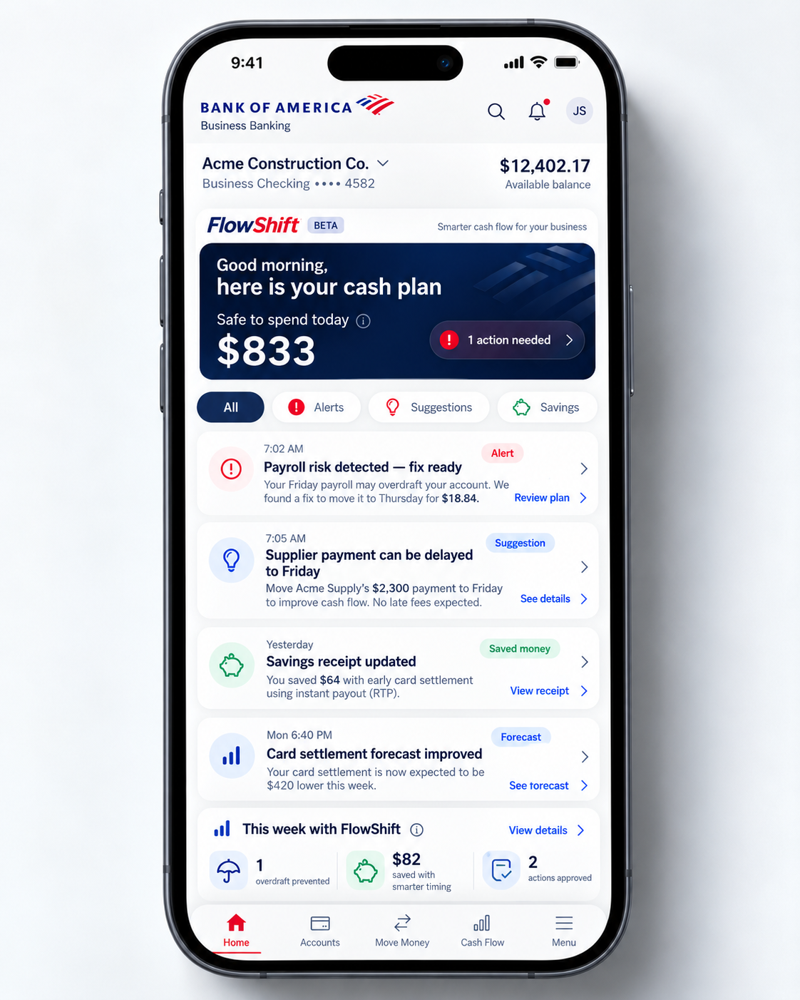

# FlowShift

**Engineering handoff for a small-business cash-flow planning product embedded in a bank app.**

FlowShift should tell a business owner what is safe to spend, forecast the next 14 days, protect payroll, and recommend the cheapest safe timing and rail for payments.

This repository contains the engineering handoff and a standalone [Person 3 demo](person3/README.md) for the dashboard, rules, autopilot preview, savings, notifications, and audit history. The demo uses synthetic fixtures. No real money may move in the MVP.

## Read First

1. [Product specification, use cases, edge cases, and acceptance criteria](PROJECT_SPEC.md)
2. [Seven-screen visual reference and mockup corrections](docs/SCREEN_GUIDE.md)
3. [Jack Henry documentation and integration walkthrough](docs/JACK_HENRY.md)
4. [Engineering backlog, milestones, and definition of done](docs/ENGINEERING_PLAN.md)
5. [Original eight-page proposal](assets/reference/flowshift-proposal-v2.pdf)

## The Experience



The mockups are concept references, not validated financial calculations or evidence of an integration. Bank of America branding does not imply sponsorship, affiliation, or compatibility. Build with neutral institution branding unless a bank provides permission and its own design requirements. Jack Henry and payment-network names belong to their respective owners.

## What Engineers Are Being Asked To Build

- Permissioned sandbox balance and transaction ingestion, with an explicitly labeled synthetic-data fallback.
- Confirmed recurring obligations, a conservative 14-day forecast, and an auditable Safe to Spend number.
- A deterministic optimizer using OR-Tools CP-SAT for payment timing and rail recommendations.
- Daily plan, forecast, Smart Pay, Payroll Shield, scenario comparison, rules, and Savings Receipt experiences.
- Human-approved **simulated** execution, failure handling, and a traceable audit history.
- Backtests and a repeatable 200-business synthetic demonstration.

Live payments, real autopilot, lending, billing, and marketplace distribution are later work subject to bank approval. See the specification before estimating them.

## Working Agreement

Requirements marked **MUST** are acceptance requirements. **SHOULD** means preferred, with deviations documented. Proposed engineering defaults are not PM-approved business facts: resolve the decision log before a pilot. Source conflicts are called out rather than silently copied.

Start with [Milestone 0](docs/ENGINEERING_PLAN.md#milestone-0-contract-and-access). Do not build every feature at once, hard-code mockup numbers, invent Jack Henry endpoints, publish credentials, or connect production payment credentials to a demo.

## Public Repository Safety

Only the supplied concept images, proposal, and authored documentation belong here. Do not commit customer records, developer-dashboard screenshots containing identifiers, API responses with personal data, tokens, private keys, `.env` files, or proprietary bank documentation. Public visibility is not an open-source license grant; no software or asset license is supplied by this handoff.

## Publish To GitHub

From this repository, after verifying the public-file list above, use an authenticated GitHub CLI in a terminal with Git write and network access:

```sh
gh auth status
# Run gh auth login -h github.com if authentication needs renewal.
git add .gitignore README.md PROJECT_SPEC.md docs assets/reference
git commit -m "docs: add FlowShift product and engineering handoff"
gh repo create FlowShift --public --source=. --remote=origin --push
gh repo view --json url,visibility
```

The create command targets the authenticated account. If that account already has a `FlowShift` repository, inspect it before choosing a new name or using an existing remote; do not overwrite it. Successful publication is confirmed only when the remote contains the files and visibility is `PUBLIC`.

Prepared October 19, 2026. Product source: supplied proposal v2 and seven supplied mockups. Official integration references were checked while preparing this handoff; verify them again when implementing.
