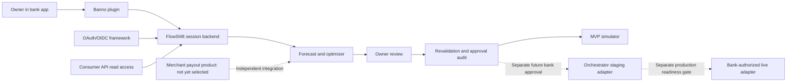

# Jack Henry Integration Playbook

Read this before estimating integration work. This is a documentation walkthrough, not a claim of provisioned access. Official public references were checked October 19, 2026. Features, credentials, test environments, entitlements, and institution onboarding must be verified again during implementation.

## 1. Choose The Correct Product Surface

Do not treat "Jack Henry API" as one interchangeable API.

| Need | Starting documentation | FlowShift boundary |
| --- | --- | --- |
| Embedded bank experience | [Banno Plugin Framework](https://jackhenry.dev/open-api-docs/plugins/) | Plugin UI integration; test host navigation, sizing, and authentication separately from a standalone demo |
| Permissioned account and transaction data | [Consumer API overview](https://jackhenry.dev/open-api-docs/consumer-api/overview/) and [API reference](https://jackhenry.dev/open-api-docs/consumer-api/api-reference/) | Discover actual account/transaction operations, business-account entitlements, fields, history, and pagination before mapping data |
| Customer authentication | [Authentication Framework getting started](https://banno.github.io/open-api-docs/authentication-framework/getting-started/) | OAuth 2.0/OIDC and access tokens; not shared bank passwords or a generic API key |
| Payment orchestration | [Payments Orchestrator getting started](https://jackhenry.dev/payments-orchestrator/docs/payments/getting-started/) | Separate product, environment, access, and authorization; a Banno token does not authorize these payments |
| Payment eligibility discovery | [PayCenter routing-number eligibility](https://api.payments.jackhenry.com/docs/pay-center-ipa/RoutingNumberEligibilityAPI/overview/) | Separate PayCenter API surface; optional discovery reference, not assumed interchangeable with Orchestrator |
| Direct bank core integration | [jXchange REST docs](https://jackhenry.dev/jxchange-rest/) | Only if the institution requires it; not needed merely because FlowShift uses Banno |
| Institutional integration program | [Fintech Integration Network](https://www.jackhenry.com/fintech-integration-network) | Discuss core-specific access and onboarding; program presence is not endorsement or universal compatibility |

The selected bank determines what can actually be accessed. A demo integration is not a marketplace listing or enablement across all institutions. A screenshot of Bank of America is not evidence it uses this integration path.

## 2. Banno Sandbox Walkthrough

Start with the official [Getting Started guide](https://jackhenry.dev/open-api-docs/getting-started/). Follow its current dashboard instructions, not guessed console labels:

1. Register a developer account and open its dashboard.
2. Generate a test user for Garden, the documented demo institution.
3. Enroll using dashboard-provided test details; complete test-user two-factor setup and confirm enrollment.
4. Generate/configure the test plugin and its external application.
5. Register redirect URIs for the selected example application's callback. Use the documented local-development exceptions only locally; production callbacks require HTTPS.
6. Run the official authentication example, then obtain a redacted account/transaction read as evidence.
7. Open the plugin in the test institution and record what works, what is missing, and what business-account entitlements remain unresolved.

Do not use real SSNs or customer account numbers for generated test-user fields. Keep dashboard identifiers and credentials out of screenshots committed to this public repository.

Official starting code: [Banno authentication example](https://github.com/Banno/consumer-api-openid-connect-example) and [Banno simple plugin example](https://github.com/Banno/simple-plugin-example). These are external examples, not installed dependencies or FlowShift implementation. Read their current README, supported flow, and license before reuse.

### Required Authentication Evidence

Engineering MUST demonstrate login success, denied consent, invalid callback/state handling, expiry, logout/revocation, and account authorization. Follow current official guidance for discovery, issuer/audience/signature checks, callback state/nonce, token lifecycle, and PKCE where applicable to the selected client flow. Store secrets server-side, not in plugin bundles. Request only confirmed necessary scopes.

The official Authentication Framework uses OAuth/OIDC tokens rather than API keys. That statement applies to that framework, **not** to every Jack Henry product. [Authentication documentation](https://banno.github.io/open-api-docs/authentication-framework/getting-started/)

## 3. Turn API Documentation Into A Data Mapping

Open the Consumer API reference and record the **actual** supported operation and fields for each requirement below. Do not copy invented endpoint paths into code. Field availability, freshness, and business entitlements are discovery questions.

| FlowShift input | What engineer must verify | Acceptance evidence |
| --- | --- | --- |
| Selected account | IDs, ownership/entitlements, type, currency | Redacted schema + allowed/denied test |
| Spendable balance | Available vs ledger semantics, holds, as-of timestamp | Balance mapping with no double subtraction |
| History | Date window, pagination, pending/posted statuses, identifiers | All pages imported once; reconciliation test |
| Transaction changes | Polling/events actually available and authorized | Refresh/failure strategy, not assumed webhook support |
| Recurring obligations | Whether actual scheduled bills/payroll exist as distinct data | Owner-confirmed/manual fallback for missing data |
| Settlements | Whether merchant pending payouts are visible | Separate merchant provider or simulator; no invented Consumer API capability |

Save a sanitized mapping document during implementation: documentation URL/version, operation, granted scope, provider field, FlowShift field, balance effect, staleness behavior, and test fixture. Do not publish raw access tokens or real transaction payloads.

## 4. Payment Integration Is A Separate Workstream

**MVP uses only the local simulator.** Staging work below is future integration guidance, not required permission to send anything.

Official Orchestrator documentation describes separate staging and production environments, with staging requests not reaching banking networks. It uses API keys combined with private-key-signed JWTs, unlike Banno's customer OAuth flow. Keep environment credentials and trust domains separate. The API supports an `Idempotency-Key` header on payment creation; FlowShift MUST supply a stable key even where the provider describes it as optional. [Orchestrator getting started](https://jackhenry.dev/payments-orchestrator/docs/payments/getting-started/), [API authorization](https://jackhenry.dev/payments-orchestrator/docs/payments/getting-started/obtaining-a-token/)

For a separately approved staging spike:

1. Request access through the official product process and confirm the sponsor/institution arrangement.
2. Use the [staging testing guide](https://jackhenry.dev/payments-orchestrator/docs/payments/guide-to-testing-in-staging/); verify environment in configuration and UI before each test.
3. Record actual counterparty, payment, status, eligibility, cancellation, limits, cutoff, and fee operations from the current reference. Do not infer contracts from marketing pages.
4. Map provider states into FlowShift's versioned state machine; implement unknown-state reconciliation before submission retries.
5. Test duplicate submissions, expired authorization, rejected payments, partial plans, missing callbacks, and cancellation after submission.
6. Have bank operations/compliance approve production controls separately. Do not turn a staging adapter into live mode with a casual UI switch.

### Webhook Safety

Orchestrator documents at-least-once delivery with duplicates and no ordering guarantee. It documents signed requests and a delivery identifier. Engineers MUST implement current signature verification over the prescribed request representation, replay defenses, deduplication, and reconciliation by payment reference. Never trust arbitrary webhook JSON to mark a payment settled. Terminal attempt states must not regress on late events; handle returns as linked new events. [Official webhook guide](https://jackhenry.dev/payments-orchestrator/docs/payments/webhooks-1/)

### Eligibility Does Not Mean Available Funds

PayCenter's documented routing-number lookup distinguishes networks and service support. It does not prove that an individual payee account is valid, that your institution can send through your chosen product, or that a merchant payout is eligible for acceleration. Treat institution, receiving service, payee account, amount, fees, and payout availability as independent gates. [Routing eligibility reference](https://api.payments.jackhenry.com/docs/pay-center-ipa/RoutingNumberEligibilityAPI/overview/)

## 5. Integration Boundary Diagram

Dashed paths are not implemented and are not MVP dependencies. The image mockups illustrate the desired experience, while this diagram shows trust and execution boundaries.

## 6. Questions To Resolve With Jack Henry / Sponsor Bank

- Which institution, core, digital product, and business-account entitlements are actually in scope?
- Which scopes, account fields, historical windows, event options, and rate limits are granted in this environment?
- Is the chosen deployment a Banno plugin, another host integration, or only a neutral standalone demo?
- Is Payments Orchestrator available for the target bank, and what separate onboarding or agreements are needed?
- Which rails are enabled for sending/receiving, at what limits, cutoffs, fees, and status/cancellation semantics?
- Who provides merchant settlement acceleration? What quote, funding, recourse, and failure contract applies?
- What payee verification, approvals, fraud screening, sanctions controls, privacy/retention, and incident duties does the bank require?

Do not promise live integration dates until these answers and credentials are confirmed. If access is blocked, keep synthetic development moving but mark the milestone blocked; do not call synthetic data a Jack Henry integration.
