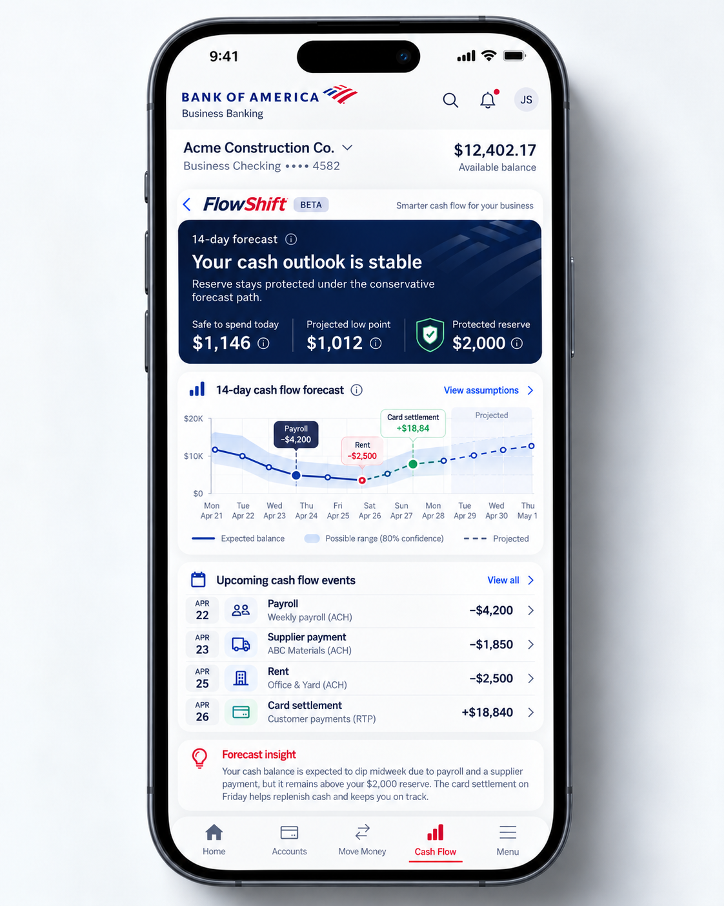
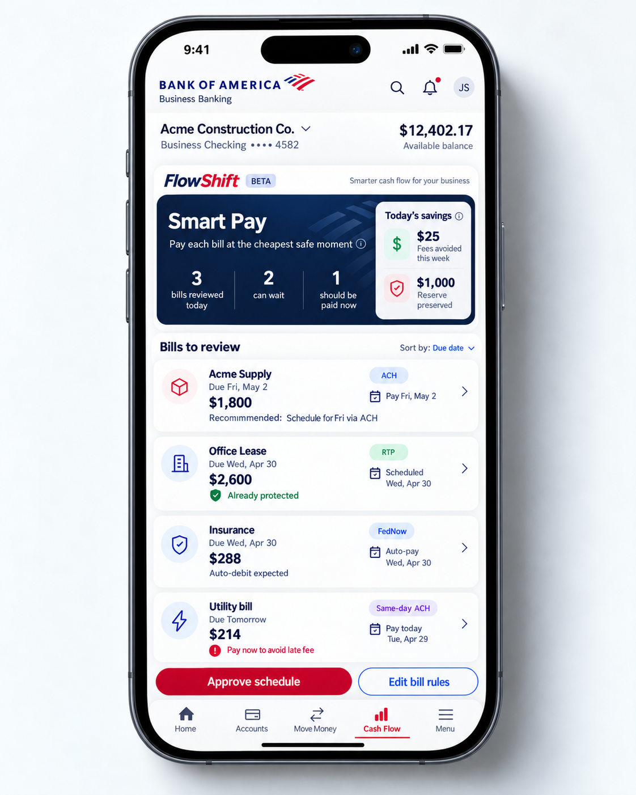
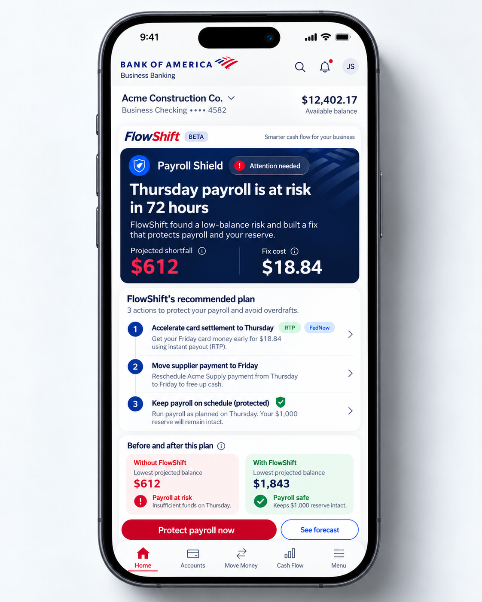
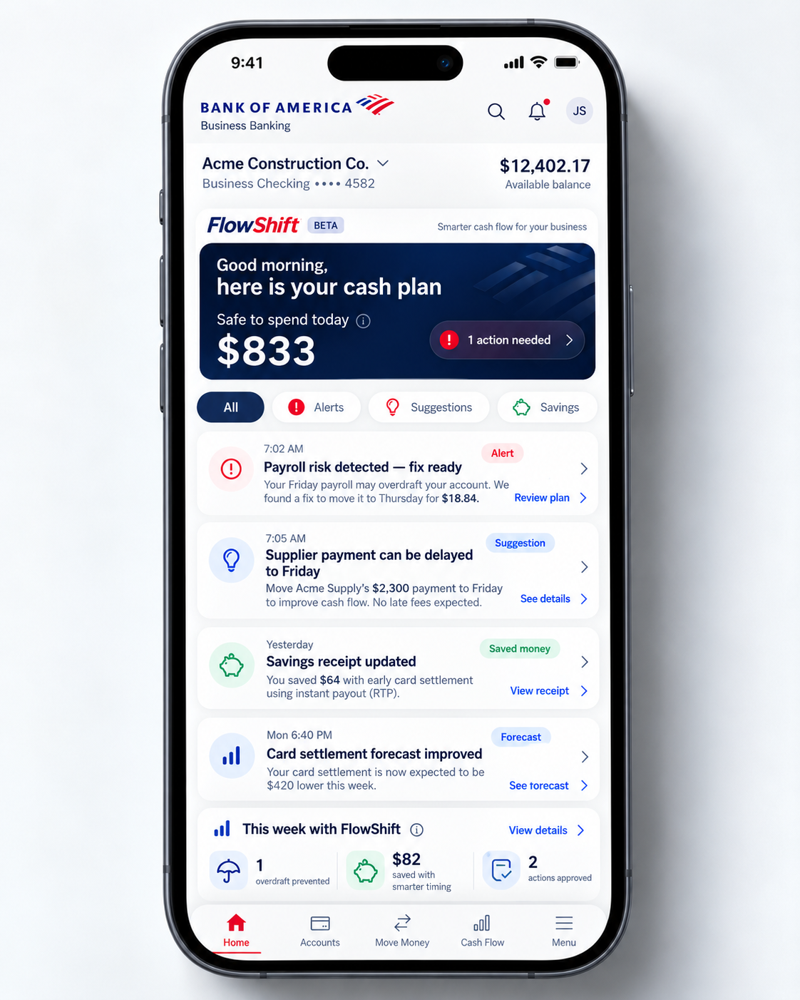
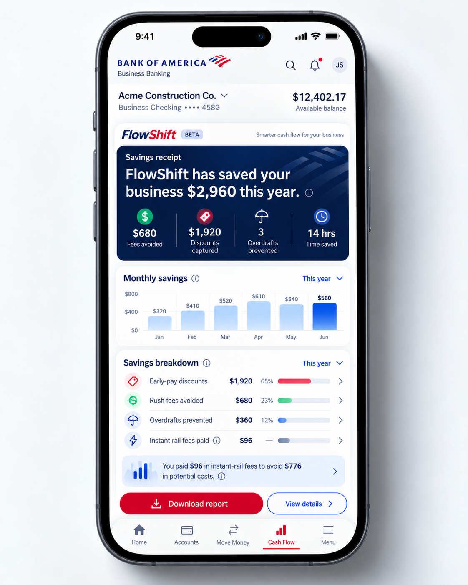
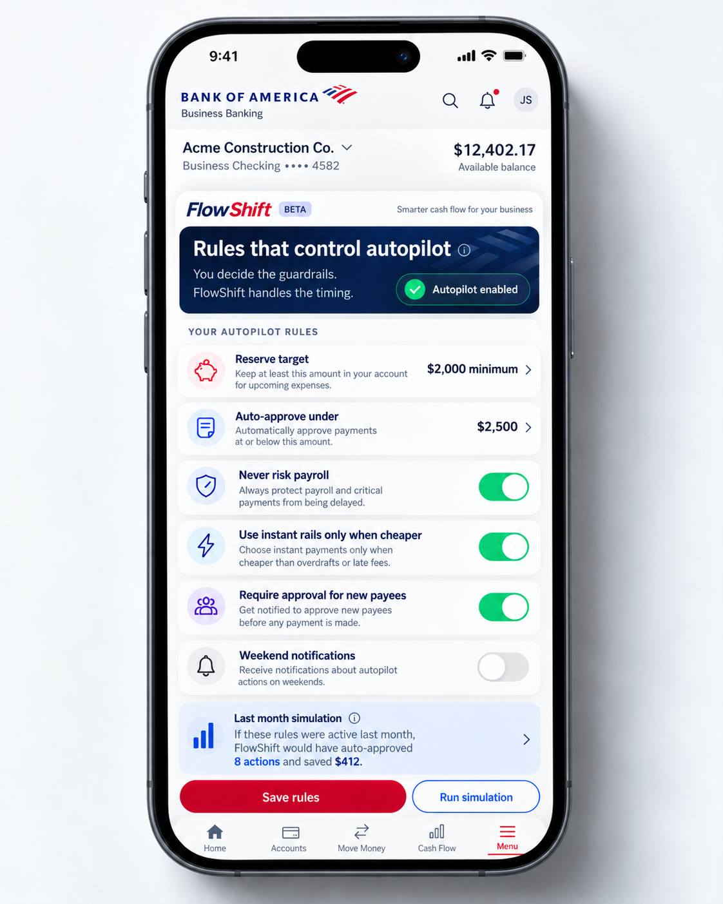
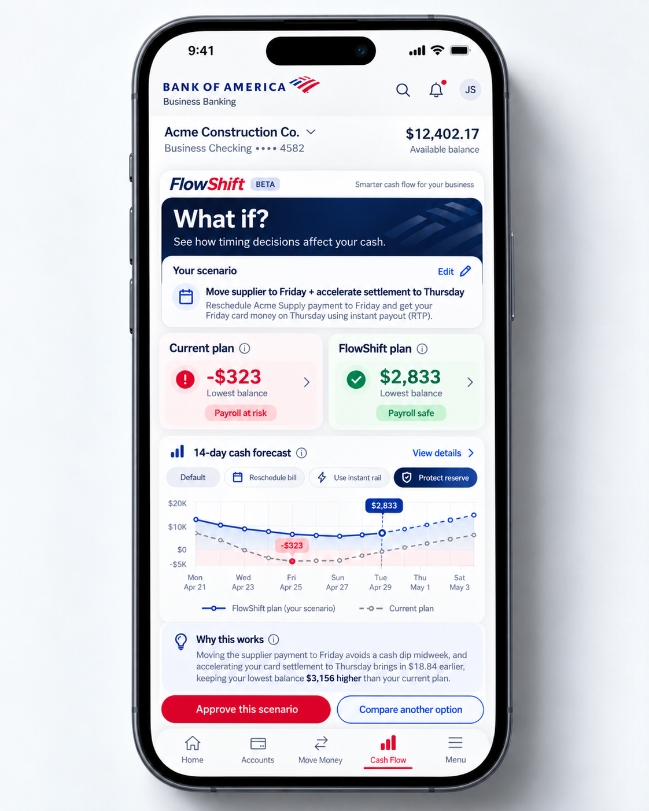

# Screen Reference Guide

These seven supplied images define product intent and information hierarchy, not executable banking behavior. Use the reconciled requirements in [PROJECT_SPEC.md](../PROJECT_SPEC.md) for calculations. All screen amounts, counts, dates, and charts MUST come from the same versioned data model.

Use neutral bank branding. Do not recreate the surrounding bank application's search, accounts, transfers, or menu unless building a clearly labeled demo shell. In a real plugin, the bank supplies host navigation; do not duplicate it. A simulated UI MUST have a visible simulation label even if the reference image does not.

## 1. Forecast

**Purpose:** Understand the next 14 days and the events driving cash changes. Maps to UC-05.

Required: Safe to Spend, absolute low point, reserve target/gap, expected balance, conservative band, reserve line, projected-versus-observed distinction, event drilldowns, as-of time, and assumptions. Chart selection and event list selection must show the same underlying event. Provide an accessible table.

Actions: back to daily plan; inspect an event; inspect assumptions; view full event list. Empty history requires onboarding, not this stable-outlook screen. The reference's $1,012 low point cannot be labeled above a $2,000 reserve.

## 2. Smart Pay

**Purpose:** Decide when and how each bill should be paid. Maps to UC-08/09/11.

Required: dynamically computed bill counts, payee, amount, due/arrival date, initiation date, recommended eligible rail, incremental fee, and movable/auto-debit/protected status. The reference lists four bills while claiming three reviewed: calculate the count.

Actions: sort bills; inspect bill terms and eligibility; edit confirmed bill rules; review schedule; approve exact jointly validated schedule. A rail badge is an eligibility-dependent recommendation, not proof that the account supports it. Third-party automatic debits are not reschedulable here.

## 3. Payroll Shield

**Purpose:** Warn before payroll funding and propose a feasible fix. Maps to UC-06/07.

Required: funding deadline/countdown, shortfall definition, fix cost, ordered actions and dependencies, before/after low points, and reserve result. Protected payroll is an obligation that stays on schedule, not an extra duplicate outgoing payment.

Actions: inspect each action; see forecast; review and approve the plan. The last button opens the explicit approval summary; it must not silently submit payments. If no feasible fix exists, replace the approval control with a manual-action state.

## 4. Daily Plan

**Purpose:** One useful number and prioritized next actions. Maps to UC-04/16/17.

Required: account context, Safe to Spend with assumptions, risk/action count, All/Alerts/Suggestions/Savings filters, event time, feed item status, and weekly outcome summary. Prioritize urgent payroll and funding issues over savings suggestions. Risk count counts distinct unresolved incidents, not each action in one plan.

Actions: open Payroll Shield, bill recommendation, receipt, forecast, and weekly details. Feed content is data-driven; a depleted filter has a useful empty state. Forecast deterioration is not itself a savings event.

## 5. Savings Receipt

**Purpose:** Make estimated product value inspectable. Maps to UC-15.

Required: reporting period, gross benefits, incremental costs, net savings, separate non-dollar counts, monthly totals, category details, attribution assumptions, and simulation labels. Time saved is not added to dollars. For the image's $2,960 gross categories and $96 rail costs, net is $2,864 if there is no overlap.

Actions: change period; inspect line items and assumptions; export CSV. Download and on-screen totals must reconcile. A future PDF report is optional, not required for MVP acceptance.

## 6. Rules And Autopilot Preview

**Purpose:** Express guardrails before granting automation. Maps to UC-13/14.

Required: reserve amount, fee-aware inclusive approval ceiling, payroll protection, instant-rail cost rule, new/changed payee approval, and notification preferences. Payroll protection is non-disableable for automation; mockup toggle styling is not permission to remove this safety rule.

Actions: save a versioned rule set; cancel unsaved changes; run a clearly labeled historical simulation; inspect which actions qualify and why. In MVP show autopilot **preview**, not "enabled" live autopilot. Historical preview must avoid using future information unavailable on each replay date.

## 7. What-If Comparison

**Purpose:** Compare timing changes before committing. Maps to UC-10/11.

Required: scenario editor, common starting snapshot, baseline/proposed low points, reserve line, costs, dependencies, and computed differences. Reserve toggle affects only the draft until rules are explicitly saved; preserve that distinction.

Actions: edit timing/eligible acceleration; compare another option; inspect forecast details; approve the exact scenario after revalidation. With the canonical fee-bearing baseline, low-point improvement is $3,156.16; it is not $3,156.16 of savings. Balance improvement and net economic benefit are different concepts.

## Shared Design Acceptance

- Amount signs, cents, dates, timezones, reserve labels, and payment statuses are consistent across all seven experiences.
- Chart and list states share a run/version; do not combine fresh balances with an old scenario.
- Review/approve controls have progress, retry, disabled, stale, and permission-denied states.
- Screen-reader semantics, keyboard navigation, and mobile text wrapping are tested. Red/green is reinforced with words and icons.
- Mockup bank marks are references only; institution host styling and accessibility take precedence in a real integration.
